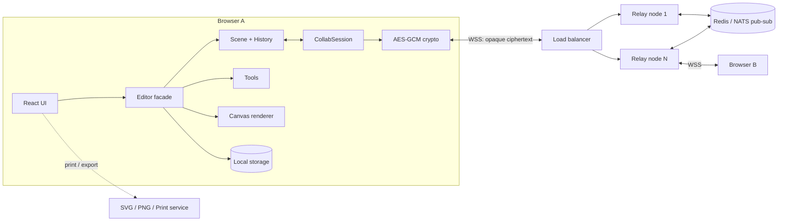
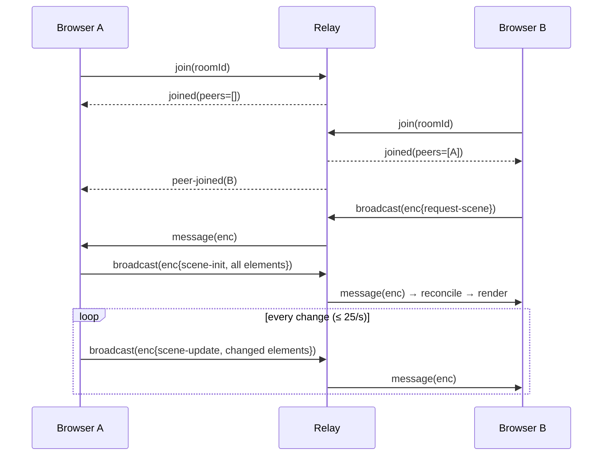
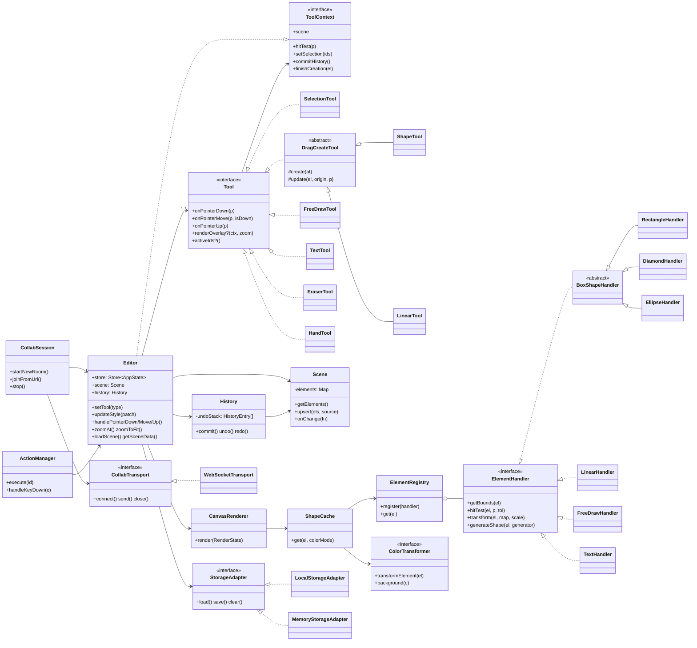
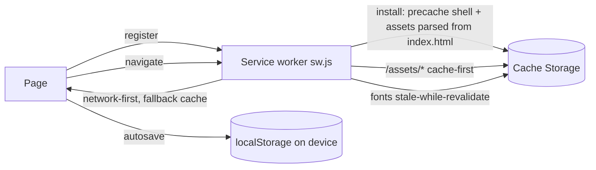

# SketchBoard — System Design

## 1. Requirements

### Functional
1. Draw rectangles, diamonds, ellipses, lines, arrows (with arrowheads), free-hand strokes and text with a hand-drawn look.
2. Select (click, Shift-click, marquee), move, resize, edit line endpoints, duplicate, copy/paste, delete, lock, reorder.
3. Style: stroke/background colour, fill pattern, stroke width & style, sloppiness, rounded edges, opacity, font size/family/alignment.
4. Undo/redo, pan/zoom (mouse, trackpad, touch pinch), grid, dark theme.
5. Page formats A5/A4/A3/A2/Letter/Legal/Tabloid, portrait/landscape, margins — or an infinite canvas.
6. Print with automatic **colour → grayscale → black & white** conversion; export PNG/SVG/JSON.
7. No account: auto-save to the browser; open/save `.sketchboard` files.
8. Real-time collaboration via an encrypted share link, with live cursors.
9. Full-bleed canvas with floating toolbars; a right sidebar (search text on canvas, libraries placeholder, encrypted chat,
   presentation mode) that can float over the canvas or be pinned/docked beside it.

### Non-functional
| Quality | Target / approach |
|---|---|
| Smooth UX | 60 fps while dragging 2 000+ elements (measured: ~16.7 ms frames). rAF-batched rendering, geometry cache, viewport culling. |
| Latency (collab) | Deltas throttled to 40 ms; cursors are “volatile” (droppable). |
| Privacy | E2E encryption; server is zero-knowledge. |
| Availability | Fully offline-capable editor; collaboration degrades gracefully with auto-reconnect. |
| Maintainability | SOLID, strict TypeScript, engine has **no React dependency**, unit-tested core. |
| Extensibility | New element types, tools, colour modes, storage backends and transports plug in without editing existing code. |

## 2. High-Level Design



* **Client-heavy architecture.** All editing, rendering, export and printing run in the browser. The server is only a relay,
  which keeps infrastructure cheap and lets the app work offline.
* **Collaboration** is peer-state based: each browser holds the full scene; peers broadcast element **deltas**; every peer applies
  the same deterministic merge rule, so they converge without server-side logic.
* **Optional cloud tier** (Excalidraw+-like: persistent rooms, team spaces) is an add-on service — see §6.

### Request flows

**Drawing a rectangle (local):** `pointerdown` → `Editor` → active `ShapeTool` (creates element after a 3 px threshold) → `Scene.upsert`
→ change event → `requestRender` (one per animation frame) + debounced autosave → on `pointerup` `History.commit()` records one undo step.

**Collaboration:**


## 3. Low-Level Design



### Key responsibilities
| Module | Responsibility |
|---|---|
| `Editor` | Facade + mediator. Owns state, routes input to the active tool, schedules renders, exposes commands. |
| `Scene` | Repository of immutable elements (incl. tombstones). Emits change events tagged `local/remote/history/load`. |
| `History` | Delta-based undo; one entry per *gesture*; ignores remote edits. |
| `ElementHandler` | Everything type-specific: bounds, hit-testing, resize transform, rough.js geometry. |
| `ShapeCache` | Memoises generated geometry in element-local space (moving = cache hit). |
| `ColorTransformer` | Colour / grayscale / black-&-white conversion used by screen preview, export and print. |
| `Tool` implementations | Pointer state machines, isolated from React/persistence/network. |
| `ActionManager` | All commands + keyboard shortcuts in one table. |
| `CollabSession` | Delta sync, encryption, presence, reconnection. |

## 4. Data model

The editor is local-first, so the “database” is the **document model**; a server-side schema is given for the optional cloud tier.

### Element (all coordinates in CSS px at 96 dpi, world space)
| Field | Type | Notes |
|---|---|---|
| `id` | string | random 20-char id |
| `type` | `rectangle \| diamond \| ellipse \| line \| arrow \| freedraw \| text` | discriminator |
| `x, y, width, height` | number | axis-aligned box |
| `points` | `{x,y}[]` | lines/arrows/freedraw, relative to `x,y` |
| style | `strokeColor, backgroundColor, fillStyle, strokeWidth, strokeStyle, roughness, opacity` | |
| `seed` | int | rough.js seed → identical wobble everywhere |
| `version` / `versionNonce` | int | conflict resolution |
| `zIndex` | float | fractional ordering: reorder without touching others |
| `isDeleted` | bool | tombstone (deletes must sync) |
| text fields | `text, fontSize, fontFamily, textAlign` | |

File/storage format: `{ type: "sketchboard", version: 1, elements: [...], appState: { pageSetup, viewport, gridEnabled, viewColorMode } }`.
Every load path (`localStorage`, file, clipboard) goes through `parseScene()` validation.

### Cloud tier schema (proposed, PostgreSQL)
```sql
CREATE TABLE users       (id uuid PRIMARY KEY, email citext UNIQUE NOT NULL, created_at timestamptz DEFAULT now());
CREATE TABLE teams       (id uuid PRIMARY KEY, name text NOT NULL, plan text NOT NULL DEFAULT 'free');
CREATE TABLE team_members(team_id uuid REFERENCES teams, user_id uuid REFERENCES users, role text NOT NULL,
                          PRIMARY KEY (team_id, user_id));
CREATE TABLE scenes      (id uuid PRIMARY KEY, team_id uuid REFERENCES teams, owner_id uuid REFERENCES users,
                          title text, page_setup jsonb, updated_at timestamptz DEFAULT now(),
                          storage_key text NOT NULL);           -- encrypted blob in object storage
CREATE INDEX scenes_team_updated ON scenes (team_id, updated_at DESC);
CREATE TABLE scene_snapshots (scene_id uuid REFERENCES scenes, version bigint, storage_key text,
                          created_at timestamptz DEFAULT now(), PRIMARY KEY (scene_id, version));
```
* Metadata (users/teams/permissions) is relational → **PostgreSQL** (ACID, joins, row-level security).
* Scene bodies are opaque encrypted blobs → **object storage (S3/GCS)**, cheap and infinitely scalable; snapshots give version history.
* A document DB (MongoDB/DynamoDB) was considered for scenes; rejected because the server can’t query encrypted content anyway, and
  blob storage is cheaper. Redis holds only ephemeral room presence.

## 5. API design

### WebSocket relay (`/` on port 3002) — JSON frames
| Direction | Message | Purpose |
|---|---|---|
| C→S | `{type:"join", roomId}` | join/switch room (re-sent on every reconnect) |
| C→S | `{type:"broadcast", payload, volatile?}` | encrypted payload to all other peers; `volatile` may be dropped under back-pressure |
| S→C | `{type:"joined", clientId, peers[]}` | ack with current peers |
| S→C | `{type:"peer-joined" \| "peer-left", clientId}` | presence |
| S→C | `{type:"message", from, payload}` | relayed ciphertext |
| S→C | `{type:"error", message}` | validation / rate-limit |

Encrypted payloads (`PeerPayload`): `request-scene`, `scene-init {elements}`, `scene-update {elements}`, `pointer {pointer, username}`,
`chat {id, text, username, at}`, `laser {points[]}` (volatile); `scene-init`/`scene-update` may carry `files[]` (image data).
`GET /health` returns `{ok, rooms, clients}` for load-balancer probes.

### Cloud REST API (proposed)
```
POST   /v1/scenes                 → {id}            create (body: encrypted blob)
GET    /v1/scenes?team=…&cursor=… → paginated list   (metadata only)
GET    /v1/scenes/:id             → encrypted blob
PUT    /v1/scenes/:id             If-Match: <etag> → optimistic concurrency
DELETE /v1/scenes/:id
GET    /v1/scenes/:id/versions    → snapshot list
```
The client plugs in by implementing `StorageAdapter` (e.g. `CloudStorageAdapter`) — no editor changes.

## 6. Design patterns & SOLID

| Pattern | Where | Why |
|---|---|---|
| Strategy + Registry | `ElementHandler`, `elementRegistry` | add element types without touching renderer/tools (OCP) |
| State | `Tool` implementations | each tool is its own pointer state machine (SRP) |
| Template Method | `DragCreateTool`, `BoxShapeHandler` | share gesture/outline lifecycle, vary only the specifics |
| Command | `ActionManager` / `ACTIONS` | buttons, menus and shortcuts share one definition |
| Facade / Mediator | `Editor` | UI talks to one object; components never talk to each other |
| Observer | `Store`, `Scene.onChange`, `Emitter` | decoupled updates; React binds via `useSyncExternalStore` |
| Memento (deltas) | `History` | cheap, collaboration-safe undo |
| Repository | `Scene` | single source of truth with tombstones |
| Adapter / DI | `StorageAdapter`, `CollabTransport` | swap localStorage↔cloud, WebSocket↔WebRTC↔test double (DIP) |
| Factory | `elements/factory.ts`, `createTools` | one place constructs valid objects |
| Composition root | `App.createServices` | builds the object graph once and injects it |

* **S** — renderer only draws, tools only interpret input, Scene only stores.
* **O** — registries for elements, tools, actions, colour modes.
* **L** — every `Tool`/`ElementHandler` is interchangeable behind its interface.
* **I** — tools get the narrow `ToolContext`, not the whole `Editor`.
* **D** — high-level modules depend on `StorageAdapter`, `CollabTransport`, `ColorTransformer` abstractions.

## 7. Trade-offs & decisions

| Decision | Alternatives | Why this one |
|---|---|---|
| **Canvas 2D** rendering | SVG DOM, WebGL | Canvas handles thousands of elements without DOM cost; WebGL is overkill for sketch lines. SVG is still used for export/print (vector quality). |
| **rough.js** with fixed seeds | custom noise | battle-tested hand-drawn look; seeds make output deterministic across peers and exports. |
| **Immutable elements + version** | mutable objects | enables cheap undo diffs, render-cache keys and conflict resolution. |
| **Delta LWW merge (version/nonce)** | OT, full CRDT (Yjs/Automerge) | element-level last-writer-wins is enough for whiteboards (two users rarely edit the same shape simultaneously), far simpler and smaller. Yjs could replace `reconcile.ts` if text co-editing is needed. |
| **Relay-only server, E2E encrypted** | authoritative server | privacy, trivial horizontal scaling, no server state to lose. Downside: no server-side history/search (solved by the opt-in cloud tier storing encrypted blobs). |
| **Fractional z-index** | ordered array | concurrent reorders don’t conflict; only moved elements change. |
| **Print via SVG in hidden iframe** | rasterise to PNG, PDF lib | true vector output at printer resolution, `@page` sets exact paper size, no extra dependency; “Save as PDF” is free. |
| **localStorage** autosave | IndexedDB | simple and synchronous for typical sizes; `StorageAdapter` lets us move to IndexedDB for very large boards. |

### CAP
The collaboration layer chooses **AP**: during a partition each peer keeps editing locally (available) and peers converge once
reconnected (eventual consistency via deterministic merge + full `scene-init` on rejoin). Strong consistency would block drawing
on network hiccups — unacceptable for a whiteboard. The proposed cloud metadata store (users/teams/permissions) is **CP** (PostgreSQL),
where correctness matters more than availability.

## 8. Scalability & reliability

* **Rendering:** rAF-coalesced redraws; `ShapeCache` keyed by geometry signature in local space (moves never regenerate rough paths);
  viewport culling; coalesced pointer events for smooth free-hand; Douglas-Peucker simplification of strokes; PNG export capped at 16 MP.
* **Relay:** stateless → scale horizontally behind a load balancer. Replace `InMemoryRoomBroker` with a Redis/NATS pub-sub broker so peers on
  different nodes share rooms (no sticky sessions). Per-connection token-bucket rate limit, 5 MB max frame, back-pressure dropping of volatile
  cursor frames, heartbeat ping/terminate, origin allow-list, graceful shutdown.
* **Client resilience:** exponential-backoff reconnect, queued non-volatile messages while offline, re-join + `request-scene` on reconnect,
  protected IDs so remote updates never clobber an in-progress drag/typing session, stale-cursor pruning.
* **Data safety:** debounced autosave + save on `beforeunload`; validated imports; tombstones keep deletes consistent; joining a room never
  overwrites your local drawing.

## 9. Pen input, ink & images

**Input pipeline (palm rejection).** `Editor` lets exactly one pointer own a tool gesture (`activePointerId`). While a pen is down every
touch is ignored (resting palm). The first `pointerType === 'pen'` event switches on *Pen mode*: the pen draws, one finger pans, two
fingers pinch-zoom. Coalesced pointer events feed every hardware sample to ink tools; the canvas disables iOS callouts/magnifier.

**Ink model.** `FreeDrawElement { points, pressures[], kind: 'pen' | 'highlighter' }`.
* Pen → `strokeOutline.ts` turns centre-line + pressure into a filled nib outline (variable width, round caps). Mouse/finger strokes get
  speed-simulated pressure and tapered ends. Points are stored raw so the stroke can be re-rendered at any zoom/export resolution.
* Highlighter → fixed-width band, 45 % opacity, `multiply` blending (canvas `globalCompositeOperation`, SVG `mix-blend-mode`).
* Draw to shape → `shapeRecognition.ts`: open strokes tested for straightness; closed strokes simplified (Douglas–Peucker) and classified by
  corner count + corner positions (rectangle vs diamond vs triangle) or radial variance (ellipse). Conversion is its own undo step.
* Laser → `LaserLayer`, ephemeral trails (never in the scene), broadcast to peers as volatile `laser` payloads.

**Images.** `ImageElement { fileId }` keeps pixels out of the scene: `FileStore` holds `BinaryFile { id, mimeType, dataURL }`, persists them in
**IndexedDB** (localStorage is too small), embeds them in `.sketchboard` files/clipboard, and sends each file to a room once (piggy-backed on
the first `scene-update`/`scene-init` that references it). Inputs: picker, `paste` event (`clipboardData.files`), Async Clipboard API, drag & drop.
Photos > 2000 px or > 1.5 MB are re-encoded to WebP. Print/export apply grayscale/B&W via CSS filters.

**Text.** `TextElement` gained `fontWeight`, `fontStyle`, `underline`; `fontFamily` is a built-in id or any font name. `core/fonts.ts` holds the
catalogue, heading presets (H1 48 / H2 36 / H3 28 bold, P 20), lazy Google Fonts loading, and SVG `@import` generation. When a web font finishes
loading, text boxes are re-measured without bumping their version (derived data → no sync/undo noise).

**Palm rejection** (refined): touches are rejected for their whole lifetime when they start while the pen is down, within
1.2 s of any pen activity (down/move/hover/up), or with a contact patch > 40 px. A pen landing cancels any touch gesture in progress
(discarding a palm's partial stroke via `Tool.onCancel`). Pen/mouse are single-contact devices, so a new down while a gesture is still
"active" ends the stale gesture (lost `pointerup`) instead of blocking input; `lostpointercapture` ends gestures cleanly. The active gesture
always receives its `pointerup`, even during a pinch. Draw-to-shape ignores strokes under 70 screen px so handwriting stays ink.

### Pages, header & footer
`page/pageLayout.ts`: pages are stacked vertically from the origin with a 48 px gap; `requiredPageCount` = max(`pageSetup.pageCount`,
pages needed by content in the page column). Headers/footers/page numbers are **decorations** computed from `PageSetup`
(`header`/`footer` slots, `pageNumbers {enabled, position, format}`, `title`, tokens `{page} {pages} {date} {title}`) — never stored as
elements, so they re-flow automatically when pages are added or the paper changes. The same decoration list feeds the canvas, SVG/PNG
page exports and print (one SVG sheet per page with CSS page breaks).

### Pages panel
`ui/components/PagesPanel.tsx` + `page/pageThumbnail.ts`. Each thumbnail draws only the elements intersecting its page into a small
canvas (≈150 px wide, DPR-capped at 2). Thumbnails render **lazily** (IntersectionObserver, 200 px look-ahead) and are **debounced**
(250 ms) after scene changes, so a 200-page document costs only what's on screen. `Editor.currentPageIndex()` maps the viewport centre to a
page; `goToPage(i)` zoom-fits the page and draws a fading outline (an overlay animation, not scene data).

### Tables
`TableElement { rows, cols, colWidths[], rowHeights[], cells[][], cellPadding, headerRow, headerColor, banded, textColor, font… }`
with border = the normal stroke style, so colour modes, roughness and dash styles apply unchanged.
* `elements/table/tableLayout.ts` — pure functions: word-wrap (canvas measurement, long words split), row auto-height, cell/grid-line hit
  testing and structural edits (`insertRow/Col`, `removeRow/Col`, `resizeGrid`, `setCellText`, `distributeColumns`) that return patches, so
  each command is one undoable `updateElement`.
* `TableHandler` renders fills (body/bands/header) + rough grid lines with per-line seeds, and emits one positioned text block per cell
  (`ShapeOutput.texts`) — consumed identically by canvas, SVG export and print.
* Editing: `CellEditorOverlay` (textarea over the cell), `Editor.startCellEditing/moveEditingCell/tableCommand/updateTable`;
  the "table cursor" (last cell touched) targets row/column commands. `SelectionTool` adds a `tableLine` drag mode for grid lines and
  click-to-edit on an already-selected table. Imported files are repaired so `cells` always matches rows × cols.

## 10. Mobile & PWA

* **Manifest** (`public/manifest.webmanifest`): standalone display, theme colour, any + maskable icons, screenshots (rich install UI),
  app shortcut (*Start live session*), `file_handlers` for `.sketchboard`, `launch_handler: focus-existing`.
* **Service worker** is hand-written (no build plugin) — strategies: navigation network-first → cached shell; content-hashed `/assets/*`
  cache-first; Google Fonts stale-while-revalidate; WebSocket/API untouched. Versioned caches, old ones purged on activate.
* **Update flow**: new SW installs → waits → `PwaManager` sets `updateReady` → banner → `SKIP_WAITING` → `controllerchange` → reload.
  Installed apps also poll `registration.update()` hourly.
* **Install UX**: `beforeinstallprompt` is captured and surfaced as a menu item (no nagging); iOS gets step-by-step instructions.
* **Mobile UX**: phone layout (≤600 px) turns the properties panel into an on-demand bottom sheet, compacts the toolbar, honours
  `env(safe-area-inset-*)`; touch double-tap → text; pinch zoom; saves on `visibilitychange` (mobile rarely fires `beforeunload`).
* **Trade-off**: hand-written SW vs Workbox/vite-plugin-pwa — fewer dependencies and full control, at the cost of maintaining the caching
  rules ourselves (small surface: ~80 lines).

## 11. Edge cases handled
Zero-size shapes (creation threshold), flipping while resizing, text scaling by font size, horizontal lines (endpoint handles instead of a 0-height box),
empty text auto-removed without polluting history, locked elements ignored by move/resize/erase, StrictMode double-mount during room join,
two fingers cancelling a one-finger gesture, Escape/blur committing text, clipboard permission denial (falls back to an internal clipboard).

## 12. Extending
* **New shape** (e.g. star): add the type to `core/types.ts`, write `StarHandler implements ElementHandler`, register it, add a `ShapeTool` entry + toolbar button.
* **New colour mode** (e.g. sepia): implement `ColorTransformer`, add it to the map in `renderer/colorModes.ts` — print, export and preview get it automatically.
* **Cloud storage**: implement `StorageAdapter` against the REST API above.
* **Images, rotation, grouping, arrow binding** are natural next steps; the element model already reserves room via `ElementHandler.transform`.
